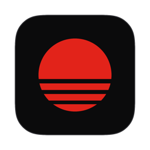
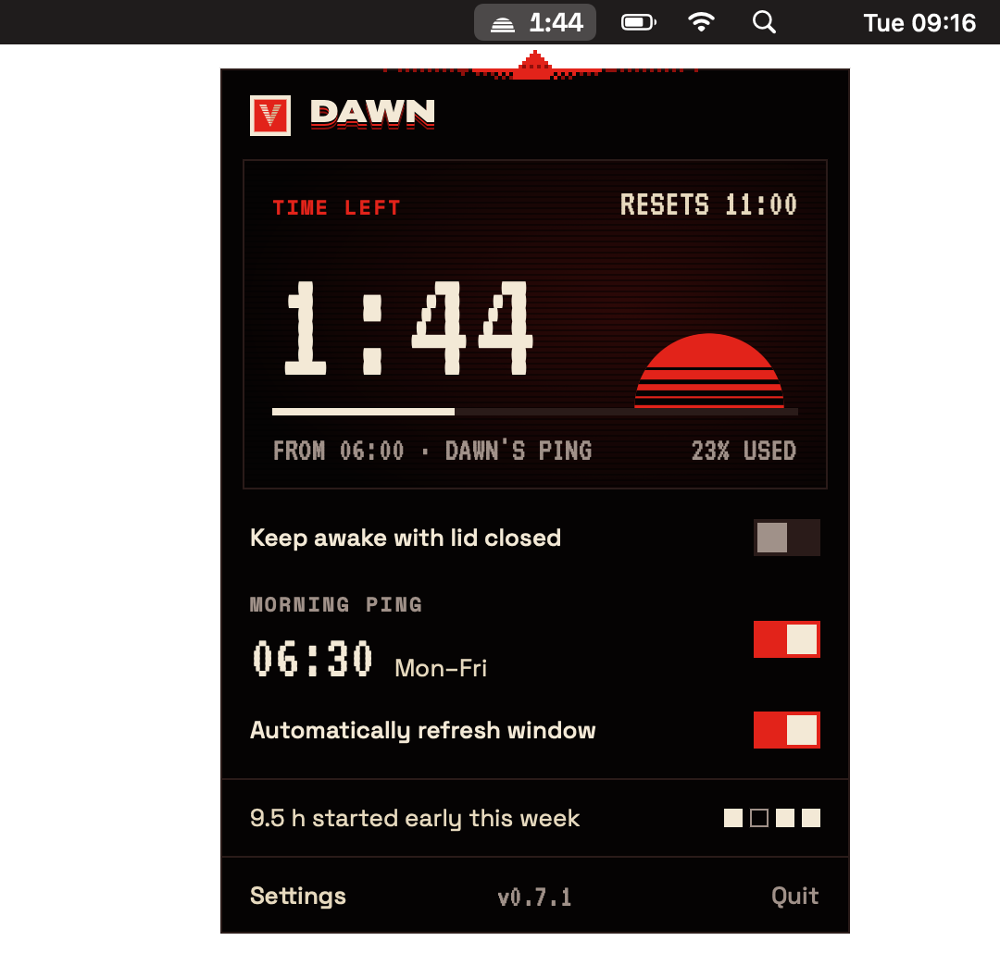

<h1 align="center">
  <br>
  Dawn
</h1>

<p align="center">Starts your 5-hour Claude window before you sit down and refreshes it automatically. A small app for the macOS menu bar.</p>

<p align="center">
  <a href="https://github.com/Kungie/dawn/releases/latest"></a>
  
  <a href="LICENSE"></a>
</p>

<p align="center"></p>

<p align="center"><a href="https://github.com/Kungie/dawn/releases/latest/download/Dawn.dmg"></a></p>

Dawn is a small menu bar app for Claude's five-hour usage window. The window starts with your first message, so Dawn sends that message early, through the official Claude Code CLI and your own login, and keeps a fresh window going through the day. It shows how much of the current one is left, and it can keep the Mac awake with the lid closed so long Claude Code runs go on.

It's mostly black and white with a red sun, it lives in the menu bar, and everything stays on your Mac.

## What it does

- **Morning ping:** at the time and on the days you pick, Dawn wakes the Mac for a minute and sends one short message to the smallest model. Your window is already running when you sit down.
- **Auto refresh:** a minute after each window resets, Dawn sends the next ping, until the next morning. If the Mac is asleep then, the ping goes out when it wakes.
- **Countdown:** time left, reset time and share used, read every two minutes from Claude Code's own `/usage`, which uses none of your limit. The menu bar shows the time, the share used or just the sun.
- **Keep awake:** one switch under the countdown stops the Mac from sleeping when you close the lid, with macOS's own `pmset disablesleep`, the way [Awayke](https://github.com/daemonphantom/Awayke) does. It turns off after the time you pick, on low battery and when Dawn quits.
- **Claude Code alerts:** with the hook added, an orange dot when Claude Code is waiting for you and a short space ping when it has finished. Click the alert to go to that session's tab or app.
- **Updates:** once a day Dawn looks for a new release on GitHub. **Update** installs it and restarts Dawn, only if it's signed with Dawn's release key. Your settings stay as they are.

## Setup

- Install [Claude Code](https://docs.claude.com/en/docs/claude-code/setup) and sign in once (`claude auth login`). Dawn never reads or stores your Claude credentials and uses no API key.
- Download `Dawn.dmg` and drag Dawn into Applications. It isn't notarized yet, so the first time open System Settings › Privacy & Security and click **Open Anyway**.
- In Settings, switch on the morning ping, pick a time and days, and click **Set up** next to *Wake the Mac*. macOS asks for your password once, because a scheduled wake is a system setting. The Mac has to be plugged in and asleep, not shut down.
- **Add** next to *Claude Code hook* writes Dawn's entries into `~/.claude/settings.json` and keeps everything else, with a backup next to it.
- Keep awake asks for your password once, the first time you switch it on. It adds a sudoers rule that allows only `pmset -a disablesleep 0` and `1`; **Remove rule** takes it out. It's system-wide while on, so plug in for long runs and never put the Mac in a bag like this.

Dawn doesn't give you more Claude: your weekly limit stays where Anthropic put it. It only moves the timing. Dawn is an independent project, not affiliated with Anthropic. Claude is a trademark of Anthropic, PBC.

## Build

You need the Xcode Command Line Tools (`xcode-select --install`).

```sh
make test     # the test suites
make app      # build/Dawn.app and Dawn.zip, plus Dawn.dmg with dmgbuild
make install  # build, then replace /Applications/Dawn.app
make release  # app, plus Dawn.zip.sig signed with the release key
```

Releases go up with `gh release create vX.Y.Z build/Dawn.dmg build/Dawn.zip build/Dawn.zip.sig`. The version in `Resources/Info.plist` and `DawnInfo.version` must match the tag.

## Licence

[AGPL-3.0](LICENSE). Inter and Geist Mono are under the SIL Open Font License, see `Resources/Fonts`.
