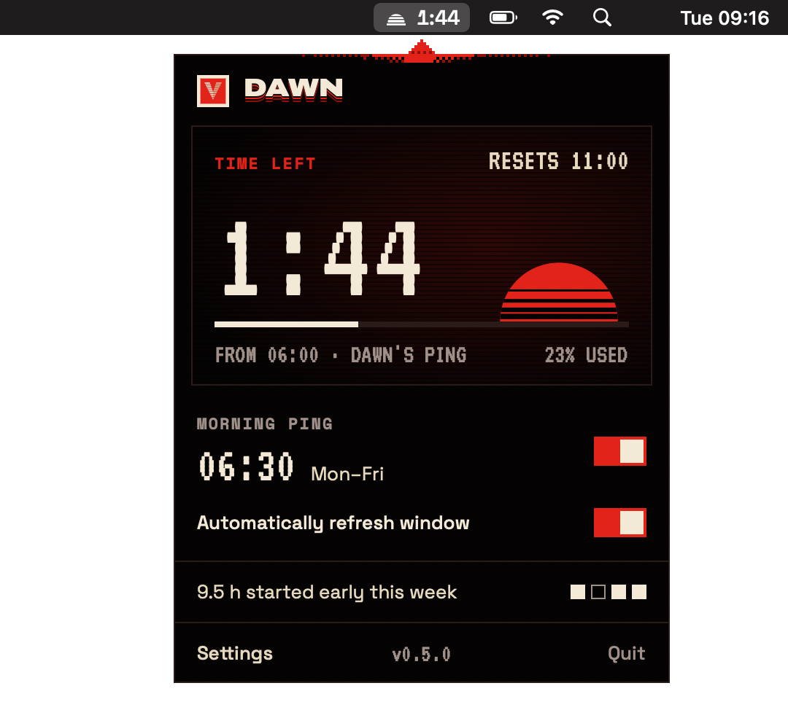

<h1 align="center">
   
  Dawn
</h1>

Starts your 5-hour Claude window before you sit down and refreshes it automatically. A small app for the macOS menu bar.

  
  
  

---

Claude's five-hour window starts with your first message. Dawn starts it earlier, so a fresh one comes sooner.

## What it does

**Morning ping.** At 06:30 (or whenever you set it) Dawn wakes your Mac and sends one tiny message through the official Claude Code CLI. Your window is already running when you sit down, and the next one is hours closer.

**Auto refresh.** A minute after each window resets, Dawn sends the next ping, so a new window is always ready. If the Mac is asleep, the ping goes out when it wakes.

**Menu bar clock.** A small sun in the menu bar, with the time left or the share used next to it if you want. The numbers come from Claude Code's own `/usage`, checked every two minutes, which costs none of your limit. With the Claude Code hook on, Dawn also shows a dot and plays a short ping when Claude is waiting for you or has finished; click it to jump to that session.

## Install

Needs macOS 13+ and [Claude Code](https://docs.claude.com/en/docs/claude-code/setup) signed in once.

Download `Dawn.dmg`, drag Dawn into Applications. It isn't notarized yet, so the first time open System Settings › Privacy & Security and click **Open Anyway**. Then open Settings in the panel, switch on the morning ping and click **Set up** next to *Wake the Mac*.

Or build it: `git clone https://github.com/Kungie/dawn.git && cd dawn && make install`

## Good to know

- Dawn never reads or stores your Claude credentials and uses no API key. It only runs `claude` on your Mac, with your own login.
- It doesn't give you more Claude: your weekly limit stays the same. It only moves the timing.
- The Mac has to be plugged in and asleep, not shut down, for the morning wake.
- Dawn is an independent project, not affiliated with Anthropic. Claude is a trademark of Anthropic, PBC.

## Licence

[AGPL-3.0](LICENSE). Fonts under the SIL Open Font License, see `Resources/Fonts`.
