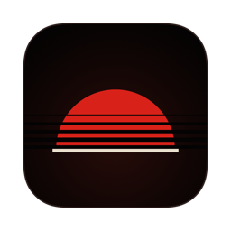
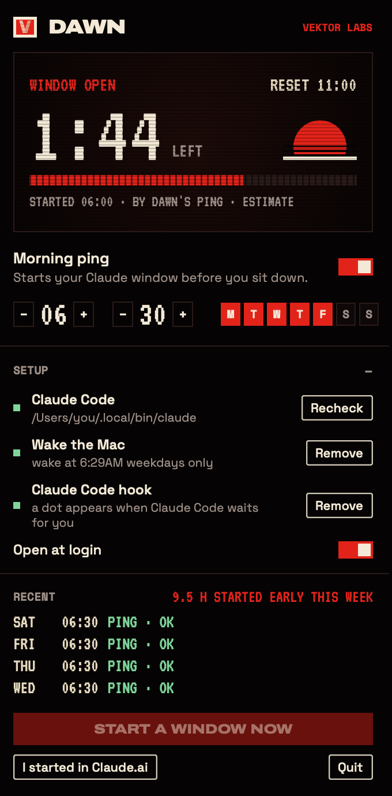
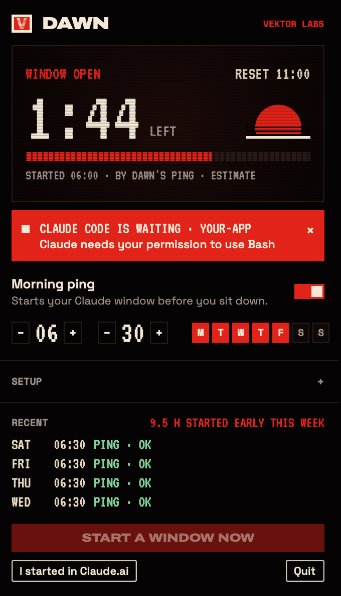

<p align="center"></p>

<h1 align="center">Dawn</h1>

<p align="center">A small macOS menu bar app that starts your Claude window before you sit down.<br>By <a href="https://github.com/Kungie">Vektor Labs</a>.</p>

---

Claude's usage window is five hours long and starts with your first message. Claude.ai, the desktop app and Claude Code all draw from the same pool. Start at nine, work properly, and you can be out of Claude by half past eleven with nothing to do until two.

Dawn moves the clock. At 06:30, or whenever you set it, it wakes your sleeping Mac for a minute and sends one tiny message through the official Claude Code command line tool, signed in with your own account. Your window starts while you're still asleep, so by the time you sit down at nine the next fresh one is two and a half hours away instead of five.

It doesn't give you more Claude. Your weekly limit stays exactly where Anthropic put it, and the ping is one short message to the smallest model. Dawn only moves the timing.

<p align="center"></p>

## What's in the menu bar

A small striped sun, and while a window is running, the time left in it. Click it and you get Dawn's screen: the countdown, when the window resets, and who started it. When no window is running it shows when the next ping goes out.

If you add the Claude Code hook (one click in Setup), the sun gets a dot whenever Claude Code is waiting for you, and the panel shows what it's asking.

<p align="center"></p>

## Install

Dawn needs macOS 13 or later and [Claude Code](https://docs.claude.com/en/docs/claude-code/setup) installed and signed in once. Build it from source with the Xcode Command Line Tools (`xcode-select --install`):

```bash
git clone https://github.com/Kungie/dawn.git
```

```bash
cd dawn && make install
```

That builds `Dawn.app`, copies it to `/Applications` and opens it. Then, in the panel, switch on **Morning ping**, pick a time and days, and under **Setup** click **Set up** next to *Wake the Mac*. macOS asks for your administrator password once, because scheduling a wake is a system setting.

The build is signed ad hoc, not notarized. If you copy it to another Mac, macOS may ask you to confirm the first launch in System Settings › Privacy & Security.

## How it works, honestly

**The ping.** Dawn runs `claude -p "ping" --model haiku` in its own folder (`~/Library/Application Support/Dawn/Dawn-ping`). That's the official CLI, using the login it already has. Dawn never reads, copies or stores your Claude credentials and never uses an API key. If a window is already running at ping time, Dawn skips the ping, since it would change nothing.

**The wake.** Dawn sets a repeating wake one minute before ping time with macOS's own `pmset`. macOS keeps only one repeating wake, so this replaces any other one you had; Dawn shows the current schedule in Setup. While the ping runs, Dawn holds a power assertion so the Mac stays awake.

**Things that can go wrong.** The Mac has to be plugged in and asleep, not shut down. On battery, macOS may skip a scheduled wake. With the lid closed, macOS sometimes drops back to sleep quickly; it's most reliable with the lid open. Check **Recent** in the panel for the first few mornings, or run `pmset -g log | grep -i wake` in Terminal.

**The countdown is an estimate.** Dawn reads the timestamps of Claude's replies in Claude Code's local logs (`~/.claude/projects`), the same logs community tools use, and rounds the window start down to the hour. It only sees Claude Code: the terminal, IDEs and the desktop app's Code tab. Chats in Claude.ai or the desktop app's chat don't appear there, so if you start your day in one of those, click **I started in Claude.ai**. Anthropic's own usage page is the source of truth.

**The hook.** *Add* writes one entry under `hooks.Notification` in `~/.claude/settings.json`, keeps everything else, and saves a backup next to it the first time (`settings.json.dawn-backup`). Claude Code then runs `Dawn hook`, which passes the message to the app and exits. *Remove* takes the entry out again.

**Privacy.** Nothing leaves your Mac except the ping itself, which goes to Anthropic through Claude Code like any other message you send. Dawn has no telemetry, no account and no server.

## Is it allowed?

Dawn only drives the official Claude Code CLI on your own Mac, with your own account, once a morning, the same as typing a message yourself at 06:30. Anthropic sets the limits and the rules and can change them. Read their terms and decide for yourself. If scheduled pings ever stop making sense, Dawn is still a decent window clock.

Dawn is an independent project by Vektor Labs and is not affiliated with, endorsed by or sponsored by Anthropic. Claude and Claude Code are trademarks of Anthropic, PBC.

## For tinkerers

Dawn is one Swift package with no dependencies. `Sources/Dawn` has the menu bar app (`DawnApp`, `PanelView`), the window estimate (`UsageLog`), the ping (`PingRunner`), the wake, hook and login item (`SystemSetup`) and the Ident theme (`Theme`). The same binary has a few command line modes:

```bash
/Applications/Dawn.app/Contents/MacOS/Dawn status
```

`status` prints what Dawn sees: where `claude` is, the scheduled wake, the hook, and the current window estimate. `hook` is what Claude Code calls. `snapshot <folder>` renders the panel with demo data (that's where the pictures above come from), and `icon <file>` draws the app icon.

`make app` builds `build/Dawn.app`, `make run` opens it, `make snapshots` refreshes the pictures in `docs/`.

## Licence

The code is MIT licensed, see [LICENSE](LICENSE). The bundled fonts (Archivo, VT323, Space Grotesk, Space Mono) are under the SIL Open Font License 1.1; their licence files sit next to them in `Resources/Fonts`.
